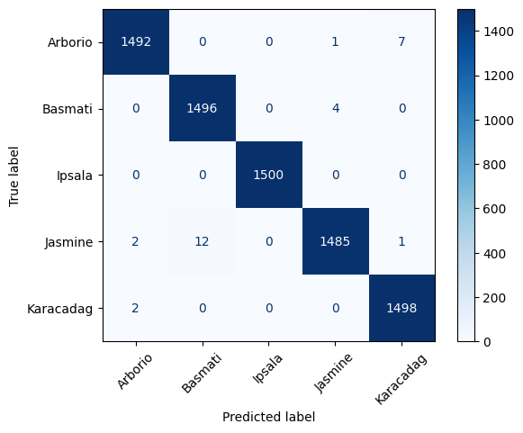
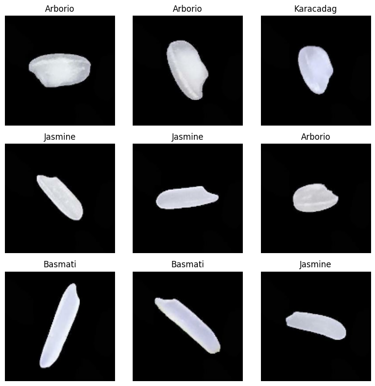
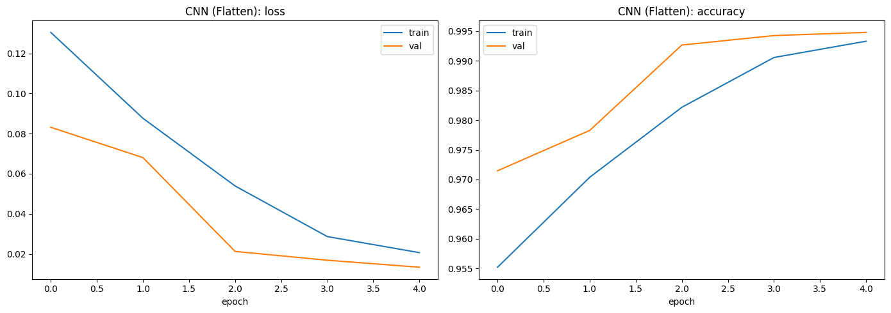
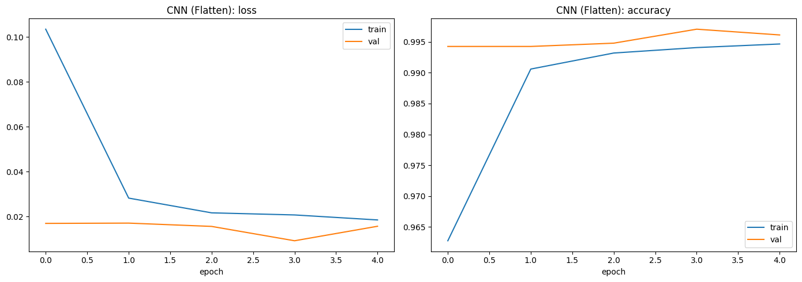
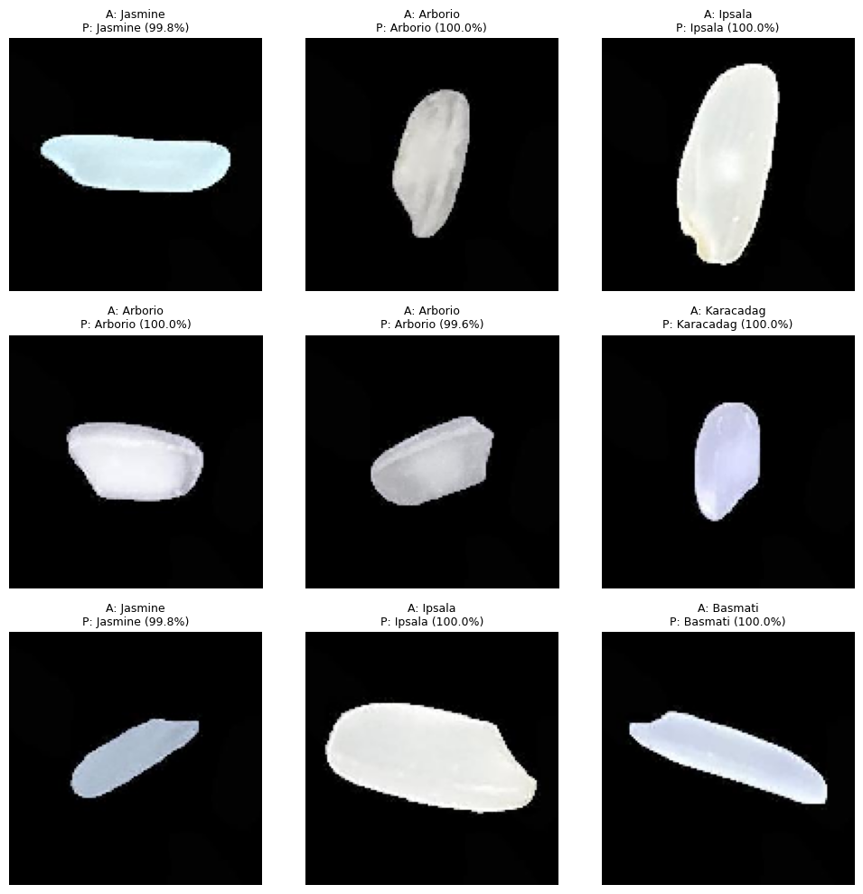

# Rice Image Classification with CNNs (Keras & PyTorch)

[](https://colab.research.google.com/github/bahar66asgharpour/rice-image-classification/blob/main/rice_category_fixed.ipynb) &nbsp; Keras
[](https://colab.research.google.com/github/bahar66asgharpour/rice-image-classification/blob/main/rice_category_pytorch_fixed.ipynb) &nbsp; PyTorch

Image classifier that identifies five rice varieties from a single grain photo. The same pipeline and the same two CNN architectures are implemented in **TensorFlow/Keras** and **PyTorch**, so the two frameworks (and the two architectures) can be compared on an identical, leakage-free data split.

**Best result: 99.76% test accuracy** (PyTorch, flatten CNN, 7,500 held-out images).

## Results

All numbers are on the **held-out test set** (7,500 images, never used for training or model selection).

| Framework | Model | Parameters | Test accuracy | Test loss |
|---|---|---|---|---|
| PyTorch | CNN (Flatten) | 4.29M | **99.76%** | 0.0076 |
| PyTorch | CNN1 (Global Avg Pool) | 0.30M | 99.55% | 0.0190 |
| Keras | CNN (Flatten) | 4.29M | 99.61% | 0.0145 |
| Keras | CNN1 (Global Avg Pool) | 0.30M | 99.23% | 0.0257 |

Per-class results for the PyTorch CNN (precision / recall / F1 are all above 99%):

| Class | Precision | Recall | F1 |
|---|---|---|---|
| Arborio | 1.0000 | 0.9947 | 0.9973 |
| Basmati | 0.9940 | 0.9980 | 0.9960 |
| Ipsala | 1.0000 | 1.0000 | 1.0000 |
| Jasmine | 0.9953 | 0.9940 | 0.9947 |
| Karacadag | 0.9973 | 1.0000 | 0.9987 |

<p align="center">
  
  
</p>
<p align="center"><em>Confusion matrices on the test set: PyTorch (left), Keras (right).</em></p>

**Takeaways**
- The simple 3-block CNN with a flatten layer is the most accurate model in both frameworks.
- The Global-Average-Pooling model (CNN1) has about **14× fewer parameters** and still reaches 99.2–99.6%, a good choice when model size matters.
- The two frameworks land within ~0.15 percentage points of each other. The preprocessing differs slightly (Keras scales pixels to [0, 1] inside the model, PyTorch normalizes to [-1, 1]), so this gap should not be over-interpreted.

## Dataset

[Rice Image Dataset](https://www.kaggle.com/datasets/muratkokludataset/rice-image-dataset) by Murat Koklu (Kaggle): 75,000 images, 15,000 per class, 5 classes: **Arborio, Basmati, Ipsala, Jasmine, Karacadag**.

The notebooks download it automatically with `kagglehub`; no manual download is needed.

<p align="center"></p>

## Method

- **Leakage-free split:** file paths are split first, with a stratified 80 / 10 / 10 split (60,000 train / 7,500 validation / 7,500 test) and a fixed seed (`42`).
- **Input:** images resized to 128×128, batch size 32.
- **Models** (both use Dropout 0.5 and a Dense(128) head with a 5-way output):
  - **CNN (Flatten):** three Conv→ReLU→MaxPool blocks (32 → 64 → 128 filters), then Flatten.
  - **CNN1 (GAP):** three blocks of *two* convolutions each (32 → 64 → 128 filters), then Global Average Pooling.
- **Training:** Adam (lr 1e-3), up to 5 epochs, with early stopping (patience 2) on validation loss. The best checkpoint is saved and restored for each model.
- **Evaluation:** the test set is used once at the end, for accuracy, a per-class classification report and a confusion matrix.

<p align="center">
  
  
</p>
<p align="center"><em>Training curves for the flatten CNN: Keras (left), PyTorch (right).</em></p>

Example predictions on random test images (A = actual, P = predicted):

<p align="center"></p>

## Repository contents

| File | Description |
|---|---|
| `rice_category_fixed.ipynb` | Keras / TensorFlow implementation |
| `rice_category_pytorch_fixed.ipynb` | PyTorch implementation |
| `requirements.txt` | Python dependencies |
| `images/` | Plots used in this README |

## How to run

**Google Colab (easiest):** click a badge at the top and run all cells. Use a GPU runtime (Runtime → Change runtime type → GPU). The notebooks were run on a T4.

**Locally:**

```bash
git clone https://github.com/bahar66asgharpour/rice-image-classification.git
cd rice-image-classification
python -m venv .venv && source .venv/bin/activate   # Windows: .venv\Scripts\activate
pip install -r requirements.txt
jupyter notebook
```

You will need Kaggle access for `kagglehub` to download the dataset (it works without setup in Colab).

## Limitations and next steps

- The dataset consists of clean, uniformly lit, centered grain images, which is why accuracy is so high. Performance on photos taken in the wild (different backgrounds, lighting, mixed grains) is untested and would likely be lower.
- Results come from a single training run per model with one seed; repeating over several seeds would give a more reliable comparison.
- Ideas to extend: data augmentation, transfer learning (e.g. MobileNetV2), and robustness tests on out-of-distribution photos.

## Tech stack

Python · TensorFlow/Keras · PyTorch · scikit-learn · NumPy · Matplotlib

## Acknowledgements

Dataset: Murat Koklu, *Rice Image Dataset*, Kaggle.

## License

Released under the [MIT License](LICENSE).
